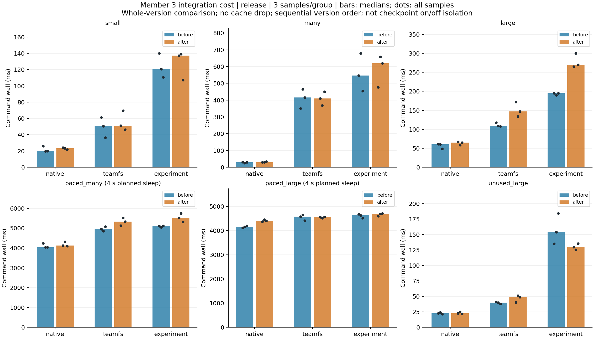
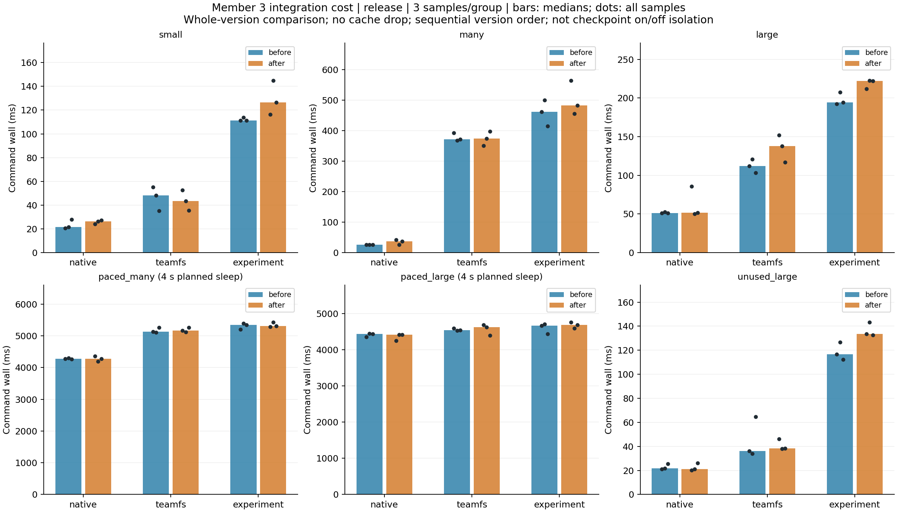

# 成员 3 两轮对照汇总（按批次分别展示）

不同批次不合并计算中位数，不作为统一基线。样本数与环境信息逐批列出。

## 批次 1：before → after

每组 3 次；与首批记录条件差异：无。

- before Python：`3.12.3 (main, Mar 23 2026, 19:04:32) [GCC 13.3.0]`
- after Python：`3.12.3 (main, Mar 23 2026, 19:04:32) [GCC 13.3.0]`

| 实验模式负载 | 旧版 ms | 新版 ms | 变化 % |
|---|---:|---:|---:|
| small | 120.717 | 137.363 | +13.79 |
| many | 546.883 | 620.145 | +13.40 |
| large | 195.094 | 269.878 | +38.33 |
| paced_many | 5108.801 | 5515.947 | +7.97 |
| paced_large | 4628.774 | 4690.297 | +1.33 |
| unused_large | 153.997 | 129.588 | -15.85 |

[本批全部模式、资源与原始证据](../20261018-member3-v1/report.md)

## 批次 2：after → before

每组 3 次；与首批记录条件差异：environment.python。

- before Python：`3.12.3 (main, Aug 31 2026, 10:18:26) [GCC 13.3.0]`
- after Python：`3.12.3 (main, Aug 31 2026, 10:18:26) [GCC 13.3.0]`

| 实验模式负载 | 旧版 ms | 新版 ms | 变化 % |
|---|---:|---:|---:|
| small | 111.245 | 126.541 | +13.75 |
| many | 461.394 | 482.666 | +4.61 |
| large | 194.248 | 221.889 | +14.23 |
| paced_many | 5348.917 | 5311.392 | -0.70 |
| paced_large | 4668.054 | 4682.250 | +0.30 |
| unused_large | 116.760 | 133.471 | +14.31 |

[本批全部模式、资源与原始证据](../20261018-member3-reverse/report.md)

共 216 个样本。若环境信息与执行顺序同时变化，不能从批次差异中单独推导顺序效应。每批内部条件匹配，仍须考虑背景活动及缓存波动。

长任务包含计划等待 4 秒。版本差值包含成员 3 整组功能变化，不是保存开关的因果对照。

[按运行批次提取的 daemon 子阶段](daemon-stages/daemon-stages.md)
