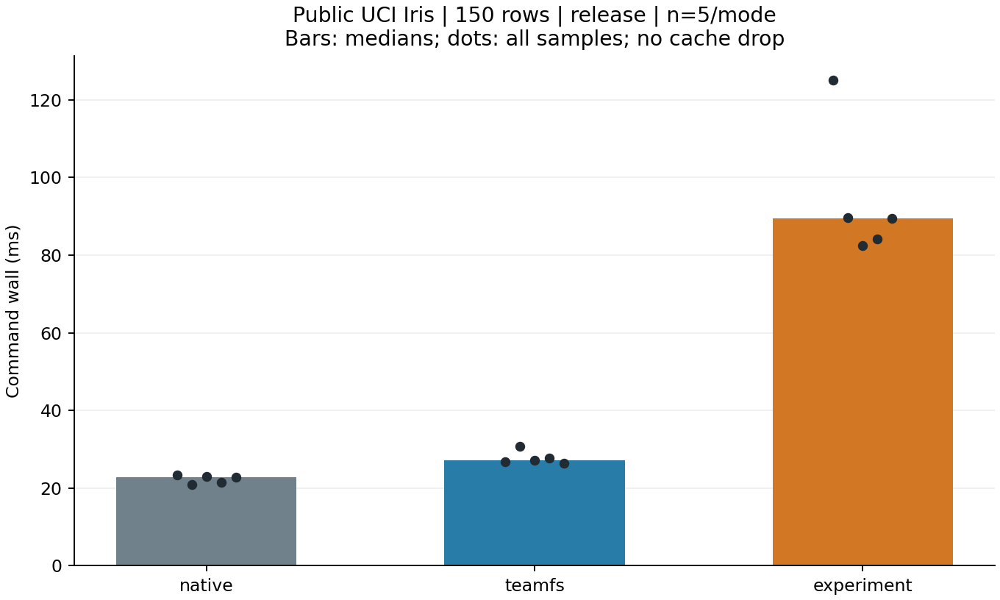

# 公开 Iris 案例性能评估

目标 `c856f3f13c0f9b31cd316949fdf70ec42be833a7`，release，每组 5 次。

使用成员 4 原始分析程序与 UCI 公开数据，150 行、4 个特征、3 类；数据文件 4551 字节。全部结果通过独立 Decimal 均值复算，三组输出逐字节一致。

| 模式 | 命令中位数 ms | 最小 ms | 最大 ms | daemon 采样峰值 MiB | 最终报告元数据字节 |
|---|---:|---:|---:|---:|---:|
| native | 22.720 | 20.864 | 23.435 | N/A | 123.000 |
| teamfs | 27.199 | 26.330 | 30.711 | 6.648 | 123.000 |
| experiment | 89.395 | 82.400 | 125.047 | 6.695 | 13033.000 |

## 独立的后续命令

以下命令在原实验结束后执行，不能与其当作嵌套阶段相加。重放前修改当前同名 iris.data，重放仍需使用旧快照并得到相同输出。

| 命令 | n | 中位数 ms |
|---|---:|---:|
| verify_cli_ms | 5 | 6.176 |
| replay_cli_ms | 5 | 89.677 |
| replay_verify_cli_ms | 5 | 5.645 |
| compare_cli_ms | 5 | 1.234 |

## 测量边界

- 各样本独立挂载和存储，模式轮换；输入准备、挂载与归档不计入命令耗时，没有清理系统缓存。
- 实验命令包含快照、初始摘要、输入/输出哈希、环境采集和报告发布；无法把模式差值全部归因于输出摘要。
- 三组均写出同样的业务结果，原生/普通模式没有实验 manifest。元数据字节指最终文件长度，不是物理写入量。
- 保持成员 4 分析程序原样，未注入 body/进程 RSS 计时，这两项为 N/A。
- 小数据案例主要体现启动和追溯固定成本，不代表大规模科学计算吞吐；单次模式顺序也未严格控制后台活动。
- 输出摘要按实际文件大小与 SHA256 核验；报告比较确认输入与输出相同；每次原实验和重放均实际 verify。

[原始汇总](../../member5/20261018-member4-iris/summary.json) / [完整证据 ZIP](../../member5/20261018-member4-iris/raw-evidence.zip)
