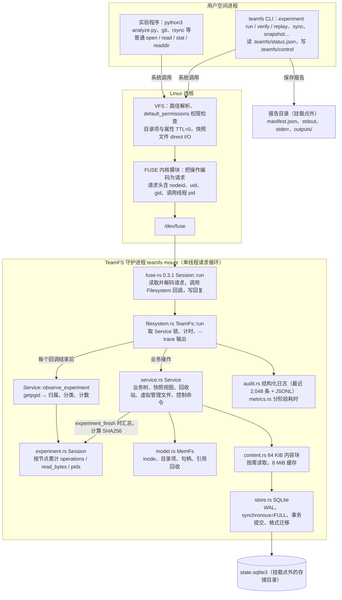
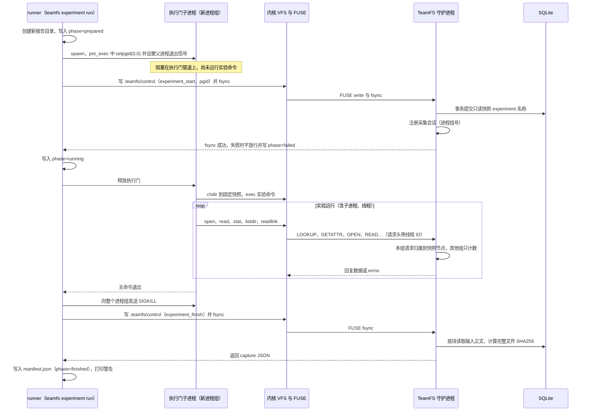

# TeamFS 架构与调用关系

本文给出应用、Linux VFS、FUSE、Rust 守护进程与 SQLite 之间的调用关系，作为答辩讲解和接口联调的依据。访问记录的判定规则见 [access-recording.md](access-recording.md)，实验命令用法见 [experiments.md](experiments.md)。图使用 Mermaid，GitHub 页面可直接渲染。

## 1. 分层调用图

关键点：

- 守护进程只有一个请求循环，所有回调、自动同步和管理命令都通过同一把 `Service` 锁串行执行。实验采集在同一把锁下完成，因此采集计数与业务操作的先后顺序一致。
- 管理命令不直接打开数据库：CLI 把 JSON 写入 `.teamfs/control` 并 `fsync`，请求作为普通 FUSE 回调进入 `Service::fsync`，再由 `Service::command` 执行。
- 结构化日志、指标和实验采集是三条独立的记录路径。日志有窗口和轮转，实验采集按会话累计，不依赖日志。

## 2. 一次实验运行的时序

报告每次更新都经过“临时文件 → fsync → rename → 目录 fsync”，异常中断时留下的是 prepared / running / failed 状态的完整 JSON，不会是半个文件。

## 3. 各层职责

| 层 | 代码或组件 | 在调用链中的作用 |
| --- | --- | --- |
| 应用 | 实验程序、CLI | 只使用普通文件接口；实验输出写到挂载点外 |
| VFS | Linux 内核 | 路径逐级解析；`default_permissions` 下按 mode 做权限检查；内核决定的失败（如把文件当目录的 ENOTDIR）直接返回，不进入 FUSE |
| FUSE 内核模块 | fs/fuse | 把 VFS 操作翻译为请求并等待回复；进程收到致命信号时中断等待 |
| fuse-rs | `fuse = 0.3.1` | 通过 libfuse 2.9 的 fusermount 挂载，之后由 Rust 直接读写 `/dev/fuse`，把请求分发到 `Filesystem` trait；未实现的回调（如 getxattr）回复 ENOSYS |
| 适配层 | `src/filesystem.rs` | 每个回调进入 `TeamFs::run`：等待锁、执行业务、调用实验采集、记录指标与日志；`--trace` 输出 `op ino pid 参数 => 结果 bytes` |
| 服务层 | `src/service.rs` | 业务树、只读快照视图（虚拟 inode）、回收站、`.teamfs` 虚拟文件、控制命令、实验会话的开始与结束 |
| 实验 | `src/experiment.rs` | runner、执行门、报告保存、verify / replay / recover；会话数据结构与线程到进程的换算 |
| 内存模型 | `src/model.rs` | inode、目录项、句柄、引用计数、树导入导出 |
| 内容与存储 | `src/content.rs`、`src/store.rs` | 不可变 64 KiB 块、按需读取与缓存；SQLite 事务保存、格式校验与迁移、进程锁 |
| 日志与指标 | `src/audit.rs`、`src/metrics.rs` | 尽力记录的诊断数据，不是实验输入清单的来源 |

SQLite 只在以下时机被访问：挂载时加载元数据；读取尚未缓存的内容块；同步、快照、清理回收站、实验开始等提交；实验结束时为输入文件计算 SHA256。普通读取不写数据库，读取快照文件也不改变业务树。

## 4. 回调与记录对照

| FUSE 回调 | Service 方法 | 实验采集 | 结构化日志 |
| --- | --- | --- | --- |
| lookup | `lookup` + `remember` | 成功计入子节点；失败按“父路径/名称”记入 errors | 只记录失败 |
| getattr | `attr` | 计入该节点 | 只记录失败 |
| open | `open` | 计入该节点；可读打开属于内容请求 | 记录 |
| read | `read` | `read_calls`、`read_bytes` | 记录，含返回字节 |
| readlink | `readlink` | `link_read`，越界链接另计 | 记录 |
| opendir、readdir | `open_dir`、`directory_entries` | `directory_listing` | 记录 |
| write、create、mkdir、unlink、rename、setattr 等 | 对应修改方法 | 不采集（固定快照只读） | 记录 |
| fsync（控制文件） | `fsync` → `command_output` | experiment_start / finish / delete | 记录为管理操作 |
| flush、release、forget、statfs | — | 不采集 | flush、release 记录；forget、statfs 不记录 |

## 5. 读取一条实验输入的代码路径

以实验程序执行 `os.pread(fd, 64, 0)` 读取固定快照中的文件为例：

1. `pread64` → VFS `vfs_read` → FUSE direct I/O 读取，发送 `FUSE_READ`（nodeid 为快照文件的虚拟 inode，pid 为调用线程）。
2. fuse-rs 解码请求，调用 `TeamFs::read`（`src/filesystem.rs`）。
3. `TeamFs::run` 记录锁等待，调用 `Service::read`：句柄类型为 `HandleData::Snapshot`，从不可变快照节点读取，内容块在缓存中缺失时经 `content.rs` 从 SQLite 取回。
4. 返回后调用 `observe_experiment(pid, "read", ino, …, Some(64))`：`getpgid` 得到进程组，`observe_in_group` 确认该 inode 属于本实验固定快照，把线程号换算为进程号，累计 `read_calls` 与 `read_bytes`。
5. 记录指标与日志，`--trace` 输出一行回调，最后 `reply.data` 把 64 字节交还内核，复制到程序的缓冲区。

管理命令走同一条路径：`teamfs sync` 写入控制文件并 fsync，对应回调进入 `Service::fsync`，执行 `Service::sync`，在 `store.rs` 中以 `BEGIN IMMEDIATE` 事务提交到 SQLite。
