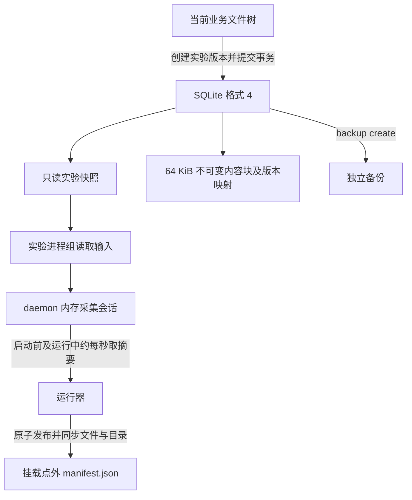
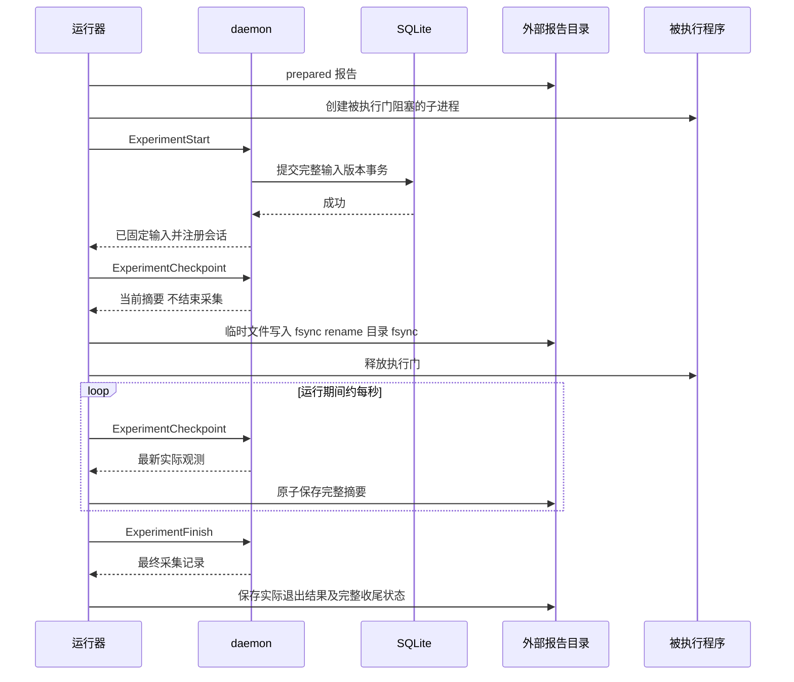

# 成员 3 输入留存与中断恢复

本次改动只涉及输入版本留存、运行中摘要保存、失败和恢复状态及相关验收。访问分类规则、科研案例、性能评估和展示页面沿用现有实现，未新增成员 2、4、5、6 的功能。

## 存储与证据的位置



SQLite 保存输入树及共享内容块。采集摘要保存于报告目录，不增加数据库格式、不依赖普通审计日志的窗口或轮转，也不隐式保存新的业务修改。报告目录中还保留原有 stdout.txt、stderr.txt 和 outputs。报告记录版本与计数，不包含输入正文。

## 保存时序



输入版本创建失败时执行门不会释放；事务回滚维持旧提交，不发布半份输入。修复存储后需要显式重新运行实验，选择新的报告目录。摘要保存失败同样停止放行或终止运行，错误会返回调用者。约一秒是两次成功轮询之间的目标等待，并不保证磁盘、哈希和锁等待也在一秒内完成。

## 状态解释

| outcome | 含义 | 退出码及证据 |
|---|---|---|
| succeeded | 程序成功且最终采集已保存 | 真实退出码 0，完整收尾 |
| program_failed | 程序非零退出或被信号终止，最终采集已保存 | 保留实际 code/signal，不等于成功实验 |
| cancelled | 运行器收到 SIGINT/SIGTERM 后停止进程组 | 保留实际观测的终止结果，不允许正常 replay |
| start_failed | 输入固定失败等启动阶段故障 | 不宣称命令执行过，不补造命令退出码 |
| capture_failed | 摘要请求、报告保存或收尾失败 | 报告不完整，可能仍保留实际已观察的退出结果 |
| daemon_unavailable | 运行器无法继续联系原 daemon，且仅有中途摘要 | 最后摘要保留，之后记录未知，不推断服务失效原因 |
| runner_interrupted | 原 daemon 中恢复了运行器丢失后的实际记录 | 不完整，未观察到的命令退出状态仍未知 |
| daemon_interrupted | 原 daemon 已丢失，恢复最后已保存摘要 | 不完整，unknown_after_checkpoint=true |

phase 是兼容旧报告的粗粒度生命周期；outcome 表达具体结果。capture_complete 只描述采集收尾，不代表算法结果正确或进程成功。新字段为 schema_version=1 的向后兼容补充。旧报告没有中途摘要时，不承诺在 daemon 重启后恢复访问记录。

## 恢复操作

```bash
teamfs experiment show <报告目录>
teamfs experiment recover <挂载点> <实验名称> <报告目录>
teamfs experiment restore <挂载点> <实验名称> recovered-inputs
teamfs sync <挂载点>
```

原 daemon 仍在时，recover 要求原进程组已不存在；EPERM 等无法判断是否结束的情形也拒绝。原 daemon 不在时，只能恢复已保存摘要，不重建内存计数、不把新会话接到旧报告上。没有有效摘要时返回错误，原报告不会被改写。未完成报告的 verify/replay 返回失败，取回输入使用 restore。恢复目标须不存在，恢复普通目录后仍遵守显式同步语义。

报告中的 daemon_session 与控制请求绑定，旧运行器不能结束新 daemon 的同名会话。checkpoint_sequence 是成功保存摘要的递增序号；checkpoint_unix 是本次摘要保存时的墙钟秒数，不能解释成逐条事件时间。capture_source=checkpoint 表示中途摘要，live_recovery 表示从原 daemon 取回的记录，final 表示正常最终收尾。

新摘要另存 input_snapshot_sha256，覆盖整个固定输入树的内容与保存的元数据。恢复时据此核对原版本，避免把删除后重新建立的同名快照认作旧输入；input_version_status 区分 matched、missing、different_version、unverified。旧报告缺少此指纹时不推断版本仍然存在。完整报告的 verify 同样核对指纹，备份导入后应保持一致。

## 报告与输入迁移

先停止实验或明确保留其中断状态，再把报告目录完整复制到独立位置。持久化挂载另行执行：

```bash
teamfs backup create <挂载点> <新备份目录>
teamfs backup verify <备份目录>
teamfs backup import <备份目录> --store <新存储目录>
teamfs mount <空挂载点> --store <新存储目录>
teamfs experiment verify <新挂载点> <已完成报告目录>
```

不能只复制 manifest.json 就认为迁移了输入。新存储保留原实验快照名称及内容，报告使用相对输入路径和 SHA256，在新挂载点重新校验。损坏备份与已有导入目标必须拒绝，不覆盖旧存储。不完整报告迁移后依然不完整，可比较其证据与输入哈希，但不能因此升级为可验证的完整报告。

memory 模式会明确输出警告并设置 input_version_persistent=false。外部报告文件可继续存在，但输入正文不跨 daemon 重启保留；此模式不能用于长期留存实验输入。已经持久化的快照也不能保证抵抗存储介质损坏，独立备份仍需另行保留。

## 验收与凭证

```bash
cargo test --locked
bash scripts/test-member3.sh
bash scripts/test-experiments.sh
bash scripts/check.sh
```

专用验收使用独立临时存储和真实 FUSE 挂载，检查连续摘要不结束采集；当前文件改写、截断和删除不改变固定输入；daemon 与运行器同时崩溃后摘要留存；仅运行器中断的恢复；成功、程序失败和取消；daemon 单独失效；blobs/nodes/metadata 事务失败与修复重试；报告加独立备份迁移；损坏与已有导入目标拒绝；memory 重启边界。

输出为 artifacts/member3-acceptance.txt、member3-acceptance.json 和 member3-trace.log。JSON 包含环境、基础提交号、工作树是否修改、原始中途摘要、恢复报告和输入 SHA256；这些是实测生成材料，不预先填入通过结论。全套回归继续覆盖原有分块、事务、恢复和软件兼容性边界。Linux 容器运行测试应使用能回收孤儿进程的 init，并开放 /dev/fuse；缺少能力属于环境限制，不能记作通过。

本轮实际环境与结果见 [成员 3 故障验收报告](member3-verification.md)。验收 JSON 另存源文件 SHA256，以标识已测试的工作树内容。
